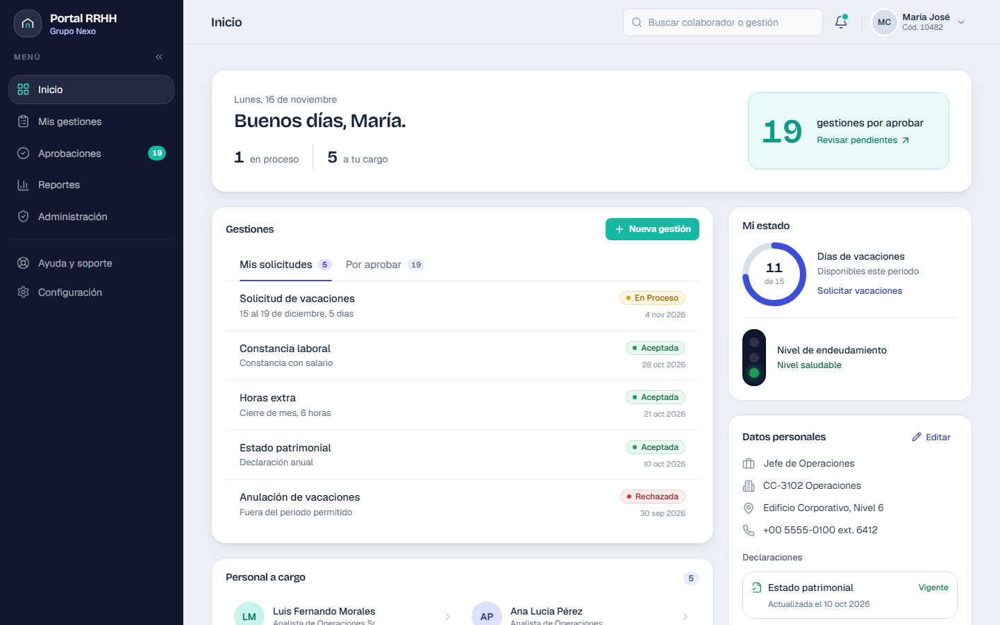

# Portal de Recursos Humanos · React + TypeScript



**[Ver demo en vivo](https://eddcas01.github.io/portal-rrhh-react/)**

> Versión de muestra de un portal de RR. HH. que desarrollé en un entorno corporativo. La marca ("Grupo
> Nexo"), los colores y todos los datos son **ficticios**. Es solo frontend y funciona con datos simulados.

Rediseño en React de un portal interno de autoservicio para colaboradores. Desde aquí se solicitan gestiones
(vacaciones, constancias, horas extra), se aprueban las del personal a cargo y se consultan los datos
personales y los reportes.

## Características

- **Dashboard** con KPIs, mis gestiones y las pendientes por aprobar (con pestañas), datos personales y
  personal a cargo.
- **Instrumentos propios del dominio**: anillo de días de vacaciones y **semáforo de endeudamiento**.
- **Gestiones**: listado filtrable y formularios de **solicitud de vacaciones** y **constancias**.
- **Layout responsive**: riel lateral colapsable (la preferencia se guarda por usuario), menú móvil y topbar
  con búsqueda, notificaciones y menú de usuario.
- **Sistema de diseño propio** con tokens de Tailwind v4 (`@theme`) y componentes reutilizables: `Button`,
  `Field`, `Modal`, `Panel`, `Ring`, `SegmentedControl`, `StatusBadge` y `Semaforo`.
- La capa de datos (`src/data/mock.ts`) está tipada y lista para reemplazarse por llamadas reales a la API.

## Stack

React 19 · TypeScript · Vite 6 · Tailwind CSS 4 · React Router 7 · lucide-react

## Ejecutar

```bash
npm install
npm run dev      # http://localhost:5273
npm run build    # genera dist/
```

## Estructura

```
src/
├─ components/
│  ├─ layout/     AppShell, Sidebar, Topbar, UserMenu, Brand, nav
│  └─ ui/         componentes del sistema de diseño
├─ features/
│  ├─ dashboard/  paneles del inicio
│  └─ gestiones/  listado y formularios de gestiones
├─ data/mock.ts   datos simulados tipados
└─ lib/utils.ts   utilidades (formato de fechas, cn)
```
